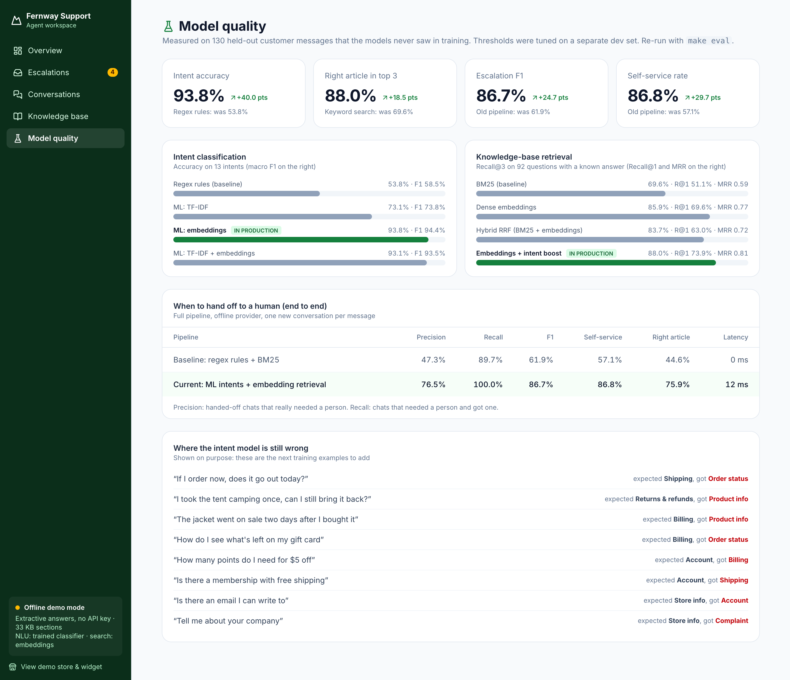
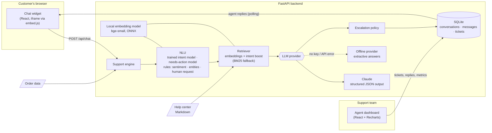

# AI Support Chatbot: customer support automation with human handoff

An embeddable AI support assistant that answers customer questions from your help center, understands what the customer wants, and hands the conversation to a human agent when it is unsure, when the customer is upset, or when they ask for a person. Support teams get a live workspace with an escalation inbox and automation metrics.

Built with **FastAPI**, **Claude** (Anthropic API) and **React**. It also runs fully offline, so you can clone it and try it in under a minute with no API key.


---

## The problem

Support teams spend most of their day answering the same questions: *Where is my order? How do I return this? Do you ship to Canada?* Customers wait in a queue for answers that already exist in the help center. Meanwhile, the conversations that really need a person (a damaged delivery, a billing error, an angry customer) wait in the same queue.

Typical chatbots make this worse: they guess, loop on "I didn't understand that", and trap customers who want a human.

## The solution

| What the customer gets | What the support team gets |
| --- | --- |
| Instant, accurate answers 24/7, grounded in the help center (no made-up policies) | Repetitive questions resolved without anyone touching them |
| Live order status from the order system | An escalation inbox, sorted by priority, with the reason and a summary for each handoff |
| A real person as soon as they need one, in the same chat window | The full transcript with the AI's intent and confidence for every reply |
| No repeated questions after the handoff | Metrics: automation rate, response times, escalations, CSAT |

## Measured, not guessed

The NLP pipeline is evaluated on **130 held-out customer messages** that no model saw during training. Every threshold was tuned on a separate dev set, so these numbers are an honest estimate. CI re-runs the eval on every push and fails if quality drops.

| | Baseline (regex rules + keyword search) | This project (trained models + embeddings) |
| --- | ---: | ---: |
| Intent accuracy (13 intents) | 53.8% | **93.8%** |
| Right help-center article in top 3 | 69.6% | **88.0%** |
| Escalation F1 (hand off exactly when needed) | 61.9% | **86.7%** |
| Customers who needed a human and got one | 89.7% | **100%** |
| Answerable questions resolved without a human | 57.1% | **86.8%** |

Median pipeline latency is 12 ms per message on CPU, without the LLM call. The full report is in [`backend/eval/results.md`](backend/eval/results.md), and it is also shown in the dashboard's **Model quality** page.



**What the evaluation showed:**
- **Embeddings beat keywords by a wide margin.** "How do I get my money back" shares no word with the refunds article, so keyword search can't find it, but its embedding sits right next to it.
- **Embeddings alone (93.8%) slightly beat embeddings + TF-IDF (93.1%)** for intents, so production uses the simpler model.
- **Mixing BM25 into the ranking made retrieval worse on this data** (83.7% vs 88.0% recall@3), so BM25 is kept only as an automatic fallback when the embedding model can't load. The fusion code stays, behind a weight set to 0, if a larger catalog with exact product names needs it.
- **Some retrieval errors are content gaps, not model errors.** The damaged-delivery article never mentioned items arriving "broken" or "torn". Improving the article raised escalation F1.
- **Known limitation:** "my tent arrived with a snapped pole" is read as a product question, so the bot cites the repairs article. It still opens a ticket for a person, which is the correct outcome.

## Features

**Conversational AI and NLP**
- **Retrieval-augmented generation (RAG) with semantic search.** The help center (Markdown files) is split into sections and embedded with a local sentence-embedding model (`bge-small-en-v1.5`, ONNX on CPU, no API key). The best-matching sections are passed to Claude, which must answer only from them and cite its sources. BM25 keyword search takes over automatically if the model can't load, and an RRF fusion of both is available.
- **Trained intent classifier.** A logistic-regression model on sentence embeddings recognizes 13 support intents and gives a probability that feeds the escalation decision. A second model detects messages that need a person to act (damaged or missing items, double charges, warranty claims), even when they use none of the usual keywords.
- **Rules for the safety-critical signals.** Explicit requests for a human, negative sentiment and order numbers are still detected with deterministic rules, so they never depend on a model's mood.
- **Claude adds its own judgment.** It returns `answer`, `intent`, `confidence`, `needs_human` and `cited_sources` as **structured JSON output** (JSON schema), so the result is always machine-readable.
- **Intent-aware retrieval.** The detected intent boosts the matching part of the knowledge base ("can I return boots I wore?" goes to the returns policy, not the boot sizing guide).
- **Evaluation harness.** A labeled train / dev / test split, a grid search on the dev set (`make tune`), a test report (`make eval`), and a CI quality gate.
- **Order lookup.** Order numbers like `FW-10234` are recognized and resolved against the order data before the answer is written.
- **Conversation context.** Short follow-ups ("and to Canada?") inherit the topic of the previous question.

**Escalation to a human**
- Clear, testable escalation policy ([`engine.py`](backend/app/engine.py)): the customer asked for a person, negative sentiment or a complaint, an issue that needs a manual action (damaged item, double charge, warranty claim), the model is unsure, confidence below the threshold, or repeated uncertain answers.
- A **ticket** is created with a priority, category, reason and summary. Billing issues and complaints get high priority automatically.
- The bot goes quiet once a human owns the conversation. Agent replies appear live in the customer's widget.

**Support team workspace**
- **Overview:** conversations, AI resolution rate, AI response time, escalation rate, agent first-reply time, time to resolve, CSAT, daily volume, top intents and escalation reasons.
- **Escalation inbox:** a priority-sorted queue, the transcript with the AI's per-message intent and confidence, a reply box, and "mark resolved".
- **Conversations:** every chat with its status and rating.
- **Knowledge base:** browse the help center and test retrieval with a live relevance score.

**Production-minded details**
- **Pluggable LLM providers** behind one interface ([`providers/base.py`](backend/app/providers/base.py)). Claude is included, and adding another model means writing one class.
- **Offline fallback:** with no API key, or if the API is unreachable, an extractive provider answers straight from the knowledge base, so the bot never just breaks.
- Refusal handling and Anthropic's server-side model fallback are enabled.
- **Embeddable anywhere** with one `<script>` tag. The widget runs in an iframe, so it never conflicts with the host site's CSS.
- The widget is responsive, keeps the conversation across page reloads, and supports keyboard use and screen-reader labels.
- 37 backend tests, plus the NLP quality gate in CI on GitHub Actions.

## Screenshots

| Self-service answer with source | Escalation creates a ticket | Agent reply arrives in the widget |
| --- | --- | --- |
|  |  |  |

**Support overview**


**Escalation inbox:** the agent sees why the AI escalated and replies in the same conversation


**Conversation transcript with intent and confidence for every reply**


**Knowledge base retrieval tester:** type a customer question and see which sections the bot would retrieve


<p align="center">
  
  &nbsp;&nbsp;
  
</p>

## Architecture



**Request flow for one customer message**

1. **NLU**: the trained model classifies the intent and detects issues that need a person. Rules add sentiment, order numbers and explicit requests for a human.
2. **Order lookup** fetches any referenced order.
3. **Retrieval** picks the most relevant help-center sections by meaning, weighted by intent.
4. **The LLM** writes the answer from that context only and returns `answer`, `intent`, `confidence`, `needs_human`, `escalation_reason` and `cited_sources` as JSON.
5. **The escalation policy** combines the NLU signals and the model's output. If it escalates, a ticket is created and the customer is told a specialist will take over in the same chat.
6. Everything is stored with its response time, so the dashboard metrics come from real data.

## Quick start

**Requirements:** Python 3.11+ with [uv](https://docs.astral.sh/uv/), and Node 20+. Or just Docker.

```bash
git clone https://github.com/sibrahimpa1/ai-support-chatbot.git
cd ai-support-chatbot
make install
make dev
```

Then open:
- **http://localhost:5173**: the demo store with the chat widget
- **http://localhost:5173/dashboard**: the support team workspace
- **http://localhost:8000/docs**: interactive API docs

On first start the database is seeded with 30 days of sample conversations, so the dashboard has data right away. Delete `backend/data/support.db` to reset it.

**With Docker** (one container serves both the API and the built frontend):

```bash
docker compose up --build
```

Open http://localhost:8000.

### Turn on Claude

The app runs in offline demo mode until you add a key:

```bash
cp .env.example .env
# set ANTHROPIC_API_KEY=sk-ant-...
```

Restart, and the dashboard sidebar switches to **Claude connected**. The model (`claude-opus-5-5` by default), the reasoning effort and the escalation threshold are set in `.env`.

### Embed it on any website

```html
<script src="https://YOUR-HOST/embed.js" defer></script>
```

See [`frontend/public/embed-demo.html`](frontend/public/embed-demo.html) (served at `/embed-demo.html`).

### Use your own content

Replace the Markdown files in [`backend/data/knowledge_base/`](backend/data/knowledge_base/). Each `## Heading` becomes one retrievable section. Connect `orders.json` to your real order system by replacing the lookup in `SupportEngine`.

### Run the tests and the evaluation

```bash
make test   # unit and API tests, frontend type-check and build
make eval   # NLP quality on the held-out test set, writes backend/eval/results.md
make tune   # grid-search thresholds and weights on the dev set
```

The first run downloads the 65 MB embedding model once into `backend/.cache/models`. The Docker image already contains it, so containers start fully offline.

## API

| Method | Endpoint | Purpose |
| --- | --- | --- |
| `POST` | `/api/chat` | Send a customer message, get the reply plus intent, confidence and escalation info |
| `GET` | `/api/conversations/{id}/messages?after=` | New messages since an id (used by the widget for agent replies) |
| `POST` | `/api/conversations/{id}/escalate` | Customer clicked "Talk to a human" |
| `POST` | `/api/conversations/{id}/feedback` | Thumbs up/down (CSAT) |
| `GET` | `/api/conversations`, `/api/conversations/{id}` | Conversation list and transcript |
| `GET` / `PATCH` | `/api/tickets`, `/api/tickets/{id}` | Escalation queue, assign or resolve |
| `POST` | `/api/tickets/{id}/reply` | Agent reply into the customer's chat |
| `GET` | `/api/metrics?days=14` | Dashboard metrics |
| `GET` | `/api/knowledge-base?q=` | List or search the knowledge base |

## Tech stack

| Layer | Technology |
| --- | --- |
| LLM | Claude via the official `anthropic` Python SDK (structured outputs, refusal fallback) |
| NLP and retrieval | Sentence embeddings (fastembed, `bge-small-en-v1.5`), scikit-learn intent and needs-action classifiers, BM25 + Reciprocal Rank Fusion, rule-based sentiment and entities |
| Evaluation | Labeled train / dev / test split, grid search, precision / recall / F1, Recall@k, MRR, CI quality gate |
| Backend | Python 3.12, FastAPI, Pydantic, SQLite |
| Frontend | React 19, TypeScript, Vite, Tailwind CSS 4, Recharts, lucide icons |
| Tooling | uv, pytest, GitHub Actions, Docker |

## Project structure

```
backend/
  app/
    main.py              FastAPI routes
    engine.py            Pipeline + escalation policy
    intents.py           NLU: rules for sentiment, entities, human requests
    intent_model.py      Trained intent and needs-action classifiers
    embeddings.py        Local sentence-embedding model
    knowledge_base.py    Markdown chunking, BM25, dense and hybrid retrieval
    providers/           LLM provider interface, Claude, offline fallback
    store.py             SQLite persistence + metrics
    seed.py              Sample history for the dashboard
  data/knowledge_base/   Sample help center (fictional store)
  data/nlu/              Training data for the classifiers
  eval/                  dev / test sets, run_eval.py, tune.py, results.md
  tests/
frontend/
  src/components/ChatWidget.tsx   The customer chat widget
  src/pages/dashboard/            Support team workspace
  public/embed.js                 One-line embed loader
```

## Roadmap

- [ ] Streaming responses (token by token) over Server-Sent Events
- [ ] LLM-as-judge evaluation of answer groundedness with Claude, next to the offline metrics
- [ ] Active learning: turn agent corrections and escalated chats into new training examples
- [ ] LLM-written ticket summaries and suggested replies for agents
- [ ] Helpdesk integrations: Zendesk, Freshdesk, Intercom, Slack alerts for urgent tickets
- [ ] Multi-language support (auto-detect and answer in the customer's language)
- [ ] Agent accounts, authentication and role-based access
- [ ] Postgres and WebSockets for multi-instance deployments

## Note

Fernway Outdoor is a fictional company. All orders, customers and conversations in this repo are sample data.

## License

[MIT](LICENSE)

## Author

Built by Senka Ibrahimpašić ([@sibrahimpa1](https://github.com/sibrahimpa1)).
