# AI Support Chatbot: customer support automation with human handoff

An embeddable AI support assistant that answers customer questions from your help center, understands what the customer wants, and hands the conversation to a human agent when it is unsure, when the customer is upset, or when they ask for a person. Support teams get a live workspace with an escalation inbox and automation metrics.

Built with **FastAPI**, **Claude** (Anthropic API) and **React**. It also runs fully offline, so you can clone it and try it in under a minute with no API key.

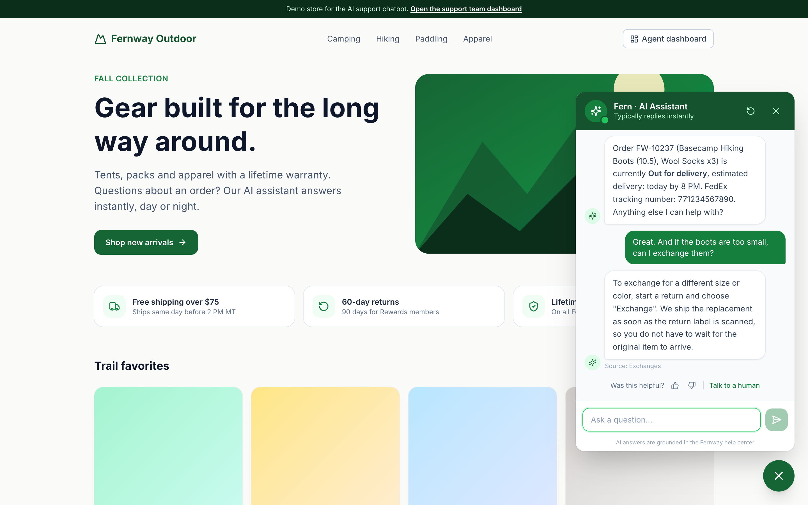

---

## The problem

Support teams spend most of their day answering the same questions: *Where is my order? How do I return this? Do you ship to Canada?* Customers wait in a queue for answers that already exist in the help center. Meanwhile, the conversations that really need a person (a damaged delivery, a billing error, an angry customer) wait in the same queue.

Typical chatbots make this worse: they guess, loop on "I didn't understand that", and trap customers who want a human.

## The solution

| What the customer gets | What the support team gets |
| --- | --- |
| Instant, accurate answers 24/7, grounded in the help center (no made-up policies) | Repetitive questions resolved without anyone touching them |
| Live order status from the order system | An escalation inbox, sorted by priority, with the reason and a summary for each handoff |
| A real person as soon as they need one, in the same chat window | The full transcript with the AI's intent and confidence for every reply |
| No repeated questions after the handoff | Metrics: automation rate, response times, escalations, CSAT |

## Features

**Conversational AI and NLP**
- **Retrieval-augmented generation (RAG).** The help center (Markdown files) is split into sections and indexed with BM25. The best-matching sections are passed to Claude, which must answer only from them and cite its sources.
- **Two-stage intent classification.** A fast rule-based NLU layer detects intent, sentiment, order numbers and "needs manual action" signals on every message. Claude then returns its own intent, a confidence score and a handoff decision as **structured JSON output** (JSON schema), so the result is always machine-readable.
- **Intent-aware retrieval.** The detected intent boosts the matching part of the knowledge base ("can I return boots I wore?" goes to the returns policy, not the boot sizing guide).
- **Order lookup.** Order numbers like `FW-10234` are recognized and resolved against the order data before the answer is written.
- **Conversation context.** Short follow-ups ("and to Canada?") inherit the topic of the previous question.

**Escalation to a human**
- Clear, testable escalation policy ([`engine.py`](backend/app/engine.py)): the customer asked for a person, negative sentiment or a complaint, an issue that needs a manual action (damaged item, double charge, warranty claim), the model is unsure, confidence below the threshold, or repeated uncertain answers.
- A **ticket** is created with a priority, category, reason and summary. Billing issues and complaints get high priority automatically.
- The bot goes quiet once a human owns the conversation. Agent replies appear live in the customer's widget.

**Support team workspace**
- **Overview:** conversations, AI resolution rate, AI response time, escalation rate, agent first-reply time, time to resolve, CSAT, daily volume, top intents and escalation reasons.
- **Escalation inbox:** a priority-sorted queue, the transcript with the AI's per-message intent and confidence, a reply box, and "mark resolved".
- **Conversations:** every chat with its status and rating.
- **Knowledge base:** browse the help center and test retrieval with a live relevance score.

**Production-minded details**
- **Pluggable LLM providers** behind one interface ([`providers/base.py`](backend/app/providers/base.py)). Claude is included, and adding another model means writing one class.
- **Offline fallback:** with no API key, or if the API is unreachable, an extractive provider answers straight from the knowledge base, so the bot never just breaks.
- Refusal handling and Anthropic's server-side model fallback are enabled.
- **Embeddable anywhere** with one `<script>` tag. The widget runs in an iframe, so it never conflicts with the host site's CSS.
- The widget is responsive, keeps the conversation across page reloads, and supports keyboard use and screen-reader labels.
- 28 backend tests and CI on GitHub Actions.

## Screenshots

| Self-service answer with source | Escalation creates a ticket | Agent reply arrives in the widget |
| --- | --- | --- |
| 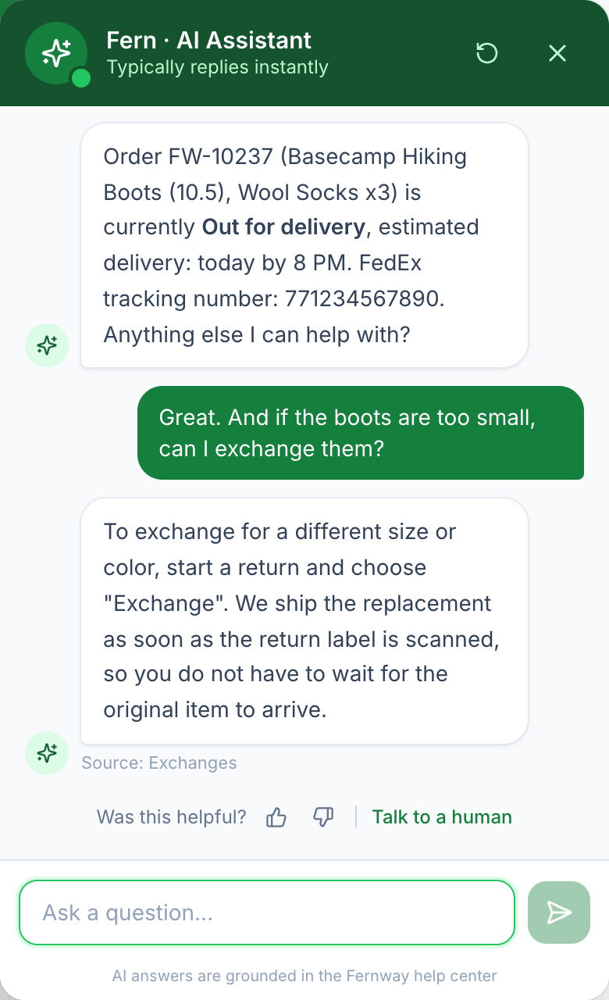 | 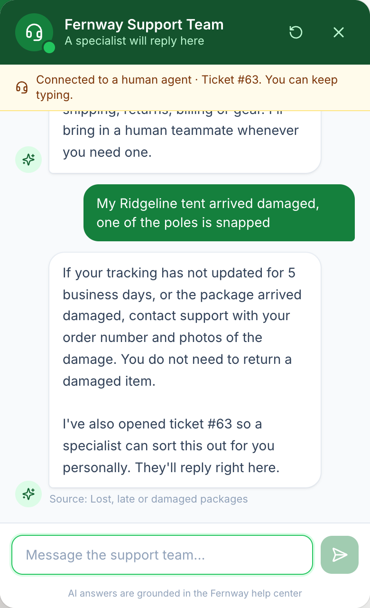 | 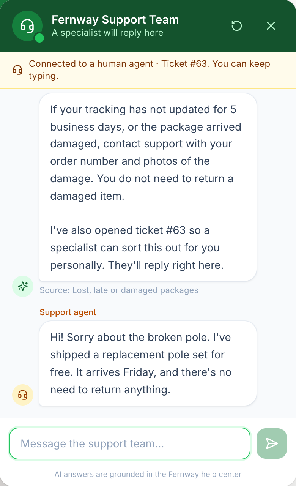 |

**Support overview**
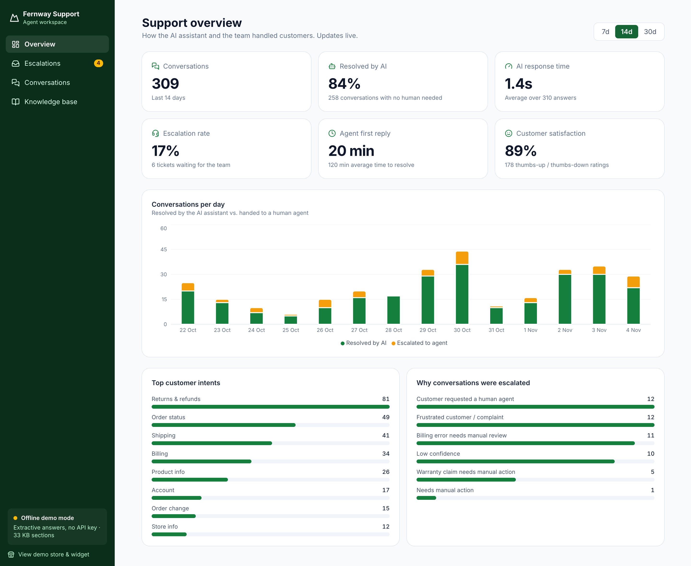

**Escalation inbox:** the agent sees why the AI escalated and replies in the same conversation
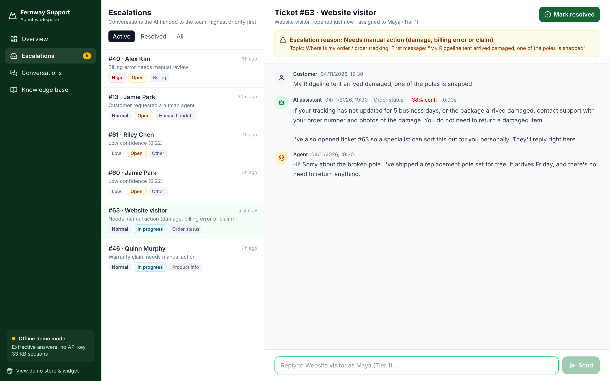

**Conversation transcript with intent and confidence for every reply**
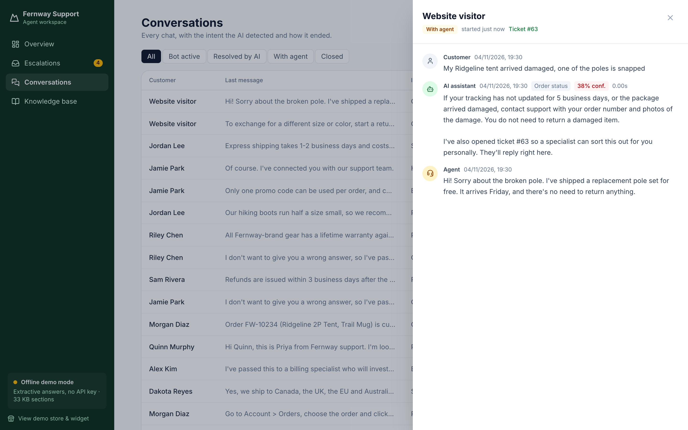

**Knowledge base retrieval tester**
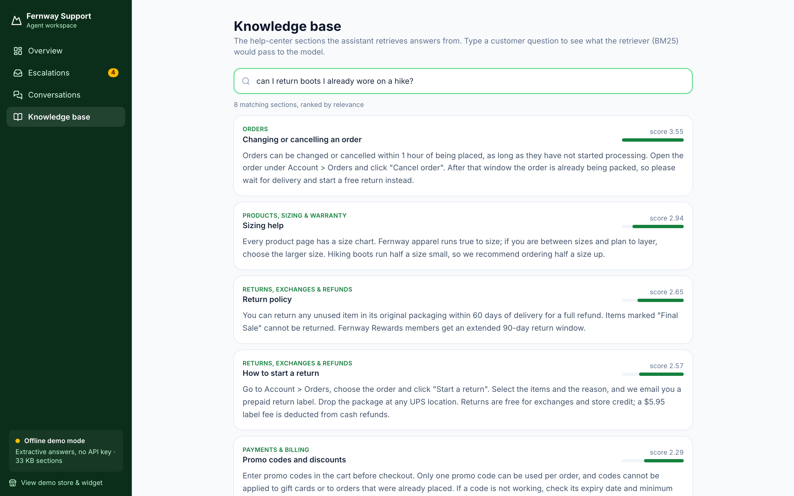

<p align="center">
  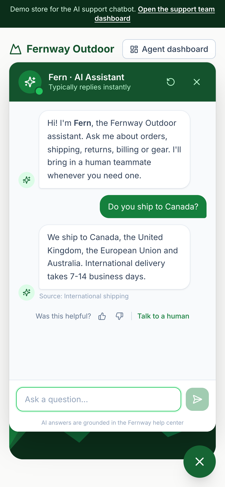
  &nbsp;&nbsp;
  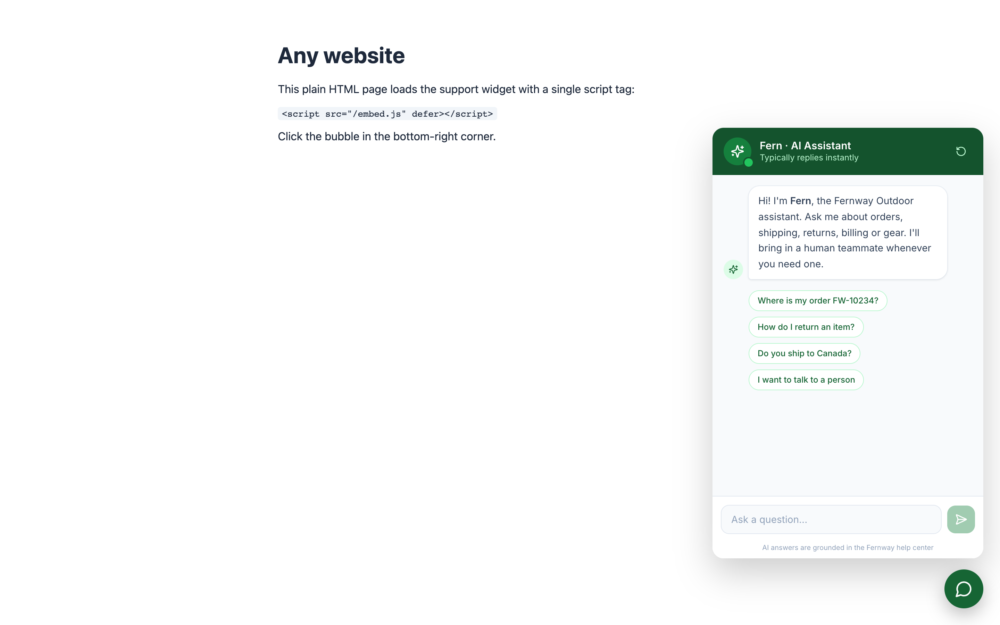
</p>

## Architecture

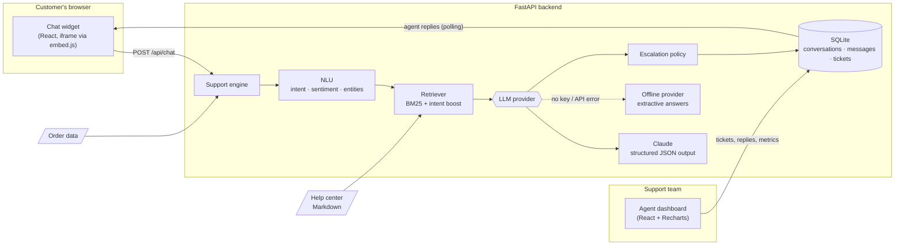

**Request flow for one customer message**

1. **NLU** classifies intent and sentiment, extracts order numbers and flags issues that need a person.
2. **Order lookup** fetches any referenced order.
3. **Retrieval** picks the most relevant help-center sections, weighted by intent.
4. **The LLM** writes the answer from that context only and returns `answer`, `intent`, `confidence`, `needs_human`, `escalation_reason` and `cited_sources` as JSON.
5. **The escalation policy** combines the NLU signals and the model's output. If it escalates, a ticket is created and the customer is told a specialist will take over in the same chat.
6. Everything is stored with its response time, so the dashboard metrics come from real data.

## Quick start

**Requirements:** Python 3.11+ with [uv](https://docs.astral.sh/uv/), and Node 20+. Or just Docker.

```bash
git clone https://github.com/sibrahimpa1/ai-support-chatbot.git
cd ai-support-chatbot
make install
make dev
```

Then open:
- **http://localhost:5173**: the demo store with the chat widget
- **http://localhost:5173/dashboard**: the support team workspace
- **http://localhost:8000/docs**: interactive API docs

On first start the database is seeded with 30 days of sample conversations, so the dashboard has data right away. Delete `backend/data/support.db` to reset it.

**With Docker** (one container serves both the API and the built frontend):

```bash
docker compose up --build
```

Open http://localhost:8000.

### Turn on Claude

The app runs in offline demo mode until you add a key:

```bash
cp .env.example .env
# set ANTHROPIC_API_KEY=sk-ant-...
```

Restart, and the dashboard sidebar switches to **Claude connected**. The model (`claude-opus-5-5` by default), the reasoning effort and the escalation threshold are set in `.env`.

### Embed it on any website

```html
<script src="https://YOUR-HOST/embed.js" defer></script>
```

See [`frontend/public/embed-demo.html`](frontend/public/embed-demo.html) (served at `/embed-demo.html`).

### Use your own content

Replace the Markdown files in [`backend/data/knowledge_base/`](backend/data/knowledge_base/). Each `## Heading` becomes one retrievable section. Connect `orders.json` to your real order system by replacing the lookup in `SupportEngine`.

### Run the tests

```bash
make test
```

## API

| Method | Endpoint | Purpose |
| --- | --- | --- |
| `POST` | `/api/chat` | Send a customer message, get the reply plus intent, confidence and escalation info |
| `GET` | `/api/conversations/{id}/messages?after=` | New messages since an id (used by the widget for agent replies) |
| `POST` | `/api/conversations/{id}/escalate` | Customer clicked "Talk to a human" |
| `POST` | `/api/conversations/{id}/feedback` | Thumbs up/down (CSAT) |
| `GET` | `/api/conversations`, `/api/conversations/{id}` | Conversation list and transcript |
| `GET` / `PATCH` | `/api/tickets`, `/api/tickets/{id}` | Escalation queue, assign or resolve |
| `POST` | `/api/tickets/{id}/reply` | Agent reply into the customer's chat |
| `GET` | `/api/metrics?days=14` | Dashboard metrics |
| `GET` | `/api/knowledge-base?q=` | List or search the knowledge base |

## Tech stack

| Layer | Technology |
| --- | --- |
| LLM | Claude via the official `anthropic` Python SDK (structured outputs, refusal fallback) |
| NLP and retrieval | Rule-based NLU (intent, sentiment, entities), BM25 retrieval with intent boosting |
| Backend | Python 3.12, FastAPI, Pydantic, SQLite |
| Frontend | React 19, TypeScript, Vite, Tailwind CSS 4, Recharts, lucide icons |
| Tooling | uv, pytest, GitHub Actions, Docker |

## Project structure

```
backend/
  app/
    main.py              FastAPI routes
    engine.py            Pipeline + escalation policy
    intents.py           NLU: intents, sentiment, entities
    knowledge_base.py    Markdown chunking + BM25 retriever
    providers/           LLM provider interface, Claude, offline fallback
    store.py             SQLite persistence + metrics
    seed.py              Sample history for the dashboard
  data/knowledge_base/   Sample help center (fictional store)
  tests/
frontend/
  src/components/ChatWidget.tsx   The customer chat widget
  src/pages/dashboard/            Support team workspace
  public/embed.js                 One-line embed loader
```

## Roadmap

- [ ] Streaming responses (token by token) over Server-Sent Events
- [ ] Vector embeddings + hybrid search for large knowledge bases
- [ ] LLM-written ticket summaries and suggested replies for agents
- [ ] Helpdesk integrations: Zendesk, Freshdesk, Intercom, Slack alerts for urgent tickets
- [ ] Multi-language support (auto-detect and answer in the customer's language)
- [ ] Agent accounts, authentication and role-based access
- [ ] An evaluation set to measure answer accuracy and escalation precision on every change
- [ ] Postgres and WebSockets for multi-instance deployments

## Note

Fernway Outdoor is a fictional company. All orders, customers and conversations in this repo are sample data.

## License

[MIT](LICENSE)
